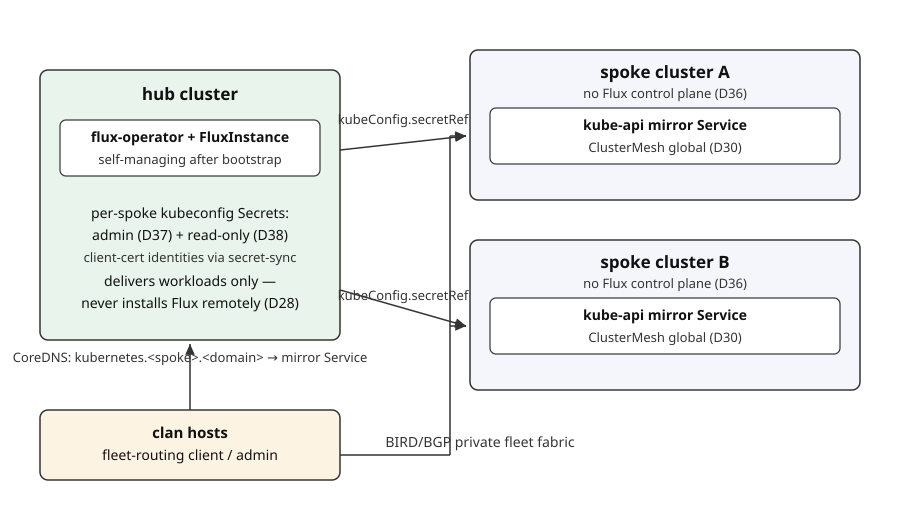

# Multi-cluster

Clusters in the same fabric form one Cilium ClusterMesh automatically —
mixed distros included, and **full mesh by default**: add a cluster instance
to the fabric and peering is rendered from exports; no CLI steps. Explicit
**selective peers** (`mesh.peers`) narrow who peers with whom (D54).

## Three graphs

Round 15 keeps three graphs separate (D54):

1. the **`netif` underlay graph** — physical/logical links, addresses, and
   gateways;
2. the **routed-fabric reachability graph** — adjacencies, eBGP sessions,
   and which prefixes may transit where;
3. the **ClusterMesh state graph** — which clusters actually peer.

State is **non-transitive**: cluster A peering with B, and B with C, does
not give A any C state or route policy. ClusterMesh peering also **bounds
the automatic cross-cluster pod/Service route policy** the fabric renders —
unpeered leaf clusters get no automatic cross-cluster pod or Service routes.
Spine transit is the deliberate, eval-visible routed-only exception: a spine
carries the union its attached leaves consume, even when a cluster on that
spine does not peer with the route's origin. One kernel FIB cannot both
withhold that route locally and forward it, so route-isolation proofs use
non-transit leaves; ClusterMesh/global-Service isolation applies on every
node. For hard trust isolation, use separate routed-fabric instances
(separate trust domains), not peering tricks.

## Mesh groups and trust domains

A mesh group is a set of mutually trusted cluster instances — and round 15
**derives it from the fabric**: a cluster's `settings.network.fabric`
reference supplies the mesh group (previously an explicit `meshGroup`
string, default `meta.domain`). The trust domain also bounds control
domains (D43): a hub and its spokes must share one fabric. But mesh ≠
control domain — standalone clusters can be full mesh members with no hub
relationship to anyone.

**One fabric = one mesh group** (D54): a cluster joins by referencing the
routed-fabric instance in `settings.network.fabric`, and consumes that
fabric's `node_transport` exports. Cross-cluster traffic uses the
fabric's per-adjacency WireGuard and FRR routes. Clusters referencing
different fabric instances never mesh; that is the trust-domain boundary.
Distro services consume **only** the generic `node_transport` export
(schemaVersion 2) — stable dual-stack node addresses/instance/endpoint,
datapath interfaces keyed by Linux name with MTU, one
`directRoutingDevice`, datapath mode + tunnel protocol, route exchange,
and exposure capabilities — never the provider-specific `routed_fabric`
export, and never a service name.

Every cluster in a mesh group uses the same datapath mode, the same tunnel
protocol, and the same `maxConnectedClusters` (D54 revised round 17).

On a local-router member, routed-fabric owns FRR's `router bgp` ASN through its
`routed-fabric-<inst>-asn` allocation. The cluster's `bgp.hostASN` setting is
only a consistency pin: leave it null or set it exactly to the transport
fact's `asn`. A different value changes only the ASN Cilium dials and is
rejected at evaluation. Remove the pin or regenerate that machine's ASN
generator to repair drift. If the allocated host ASN collides with the Cilium
ASN, either pin `bgp.ciliumASN` to a different value or regenerate the real
fabric instance's `-asn` generator; pinning `bgp.hostASN` is not a remedy.

Native members keep non-overlapping pod CIDRs: dual-stack
native-routing CIDRs cover every pod CIDR of every peered cluster, and FRR
must install cross-cluster pod routes before ClusterMesh is ready. Tunnel
members need node connectivity instead. Native routing is the
routed-fabric profile default, not a ClusterMesh mandate.

Every eligible cluster runs clustermesh-apiserver and mesh certificates from
first boot (a singleton's peer list is simply empty). Peering is rendered
into `clustermesh.config.clusters` from exports.

## ClusterMesh apiserver placement and exposure (D60)

The ClusterMesh apiserver is exposed with `externalTrafficPolicy: Local`
for **every** exposure method — ETP Local everywhere. ClientIP session
affinity is useful, but **mTLS is identity**: source preservation is not
required for identity.

**Placement selectors** choose which nodes run the apiserver: `voters`
(default — server-role nodes), `workers` (agents), `all`, or `labels`.
Labels may be only clan-declared/generated labels; a selector matching zero
nodes is an eval error.

The **exposure enum** is `auto | internal-load-balancer | node-port |
external-load-balancer`. The inventory surface (Round 17 target — not
current config) is normalized as: `mesh.peers`, `mesh.placement`
(default `voters`; `workers`/`all`/`labels`),
`mesh.placementLabels`,
`mesh.exposure` (default `auto`), `mesh.replicas`
(internal/external LoadBalancer only —
null defaults to `min(3, eligible)`; forbidden for `node-port`),
`mesh.nodePort` (default `32379`), and
`mesh.external.{loadBalancerClass,dnsName,annotations}` — required, and
used, only for `external-load-balancer`. An explicit external choice
requires the non-clan class + DNS name and works regardless of overlay
capabilities.

- **`node-port`** — no replica option: exactly one apiserver per selected
  node, via a Deployment with `replicas` = the selected-node count,
  required hostname anti-affinity + nodeSelector. All selected nodes'
  stable IPv4 addresses are published with a deterministic, collision-checked
  NodePort — **default `32379`** (the upstream default), with an optional
  explicit `mesh.nodePort` override, collision-checked per machine.
  Rolling update `maxSurge=0`, `maxUnavailable=1`.
- **`internal-load-balancer`** — ONE pinned IPv4 literal VIP from the
  existing D10 `<instance>-fabric` private pool,
  `loadBalancerClass: io.cilium/bgp-control-plane`; remote clusters connect
  to the pinned VIP; no DNS is required; existing private-pool names are
  unchanged. The VIP is **locked deterministically at host offset 79
  decimal / `0x79`** inside the pool's IPv4 `/24` block
  (analogous to the prior offset-`0x53` convention), rendered as a literal
  IPv4 address through an explicit `lbipam.cilium.io/ips`
  projection, pool-contained and collision-checked against every other
  pinned clan VIP. Control-plane exposure is **IPv4-only** on the
  validated Cilium 1.20.3 profile — the pinned chart's
  clustermesh-apiserver Deployment embeds etcd with
  `--listen-client-urls=https://0.0.0.0:2379` and the template has no
  dual-stack listener knob — so there is no ClusterMesh IPv6 VIP and no
  `RequireDualStack` advertisement; the ClusterMesh data plane stays
  dual-stack. Replica count
  is independent of placement: default `min(3, eligible)`, user-configurable
  positive ≤ eligible, with required anti-affinity; the stable VIP means no
  per-node endpoint publication; same rolling update.
- **`external-load-balancer`** — explicit external always wins on every
  overlay, regardless of capabilities. It requires an explicit non-clan
  `mesh.external.loadBalancerClass` and a `mesh.external.dnsName`
  (a DNS name only, never a literal IP), allows optional provider
  `mesh.external.annotations` (external-dns stays day-2), and needs no
  overlay internal
  capability. The external DNS name goes into peers and certificate SANs;
  dynamic, eval-unknown DNS (A record) resolution is a runtime
  prerequisite. Same
  replica and rolling-update rules as internal.
- **`auto`** (default) — chooses `internal-load-balancer` when the overlay
  publishes the `internalLoadBalancer` capability, else `node-port`;
  unsupported or no available method is an eval error. An explicit
  `internal-load-balancer` choice requires the capability.

DNS is supported by Cilium for LoadBalancer Services; external-dns remains
day-2 only. Consumers are mesh members, so the control plane takes the
fewest dependencies.

Mesh identity comes from a shared `rancher-clustermesh-ca-<group>` vars
generator (the group derived from the fabric) with per-cluster dependent
cert generators. SANs include every published IPv4/DNS endpoint; a
membership or peering change reissues certificates before the new
endpoint set is advertised. CA and cert material never appear in exports,
Helm values, or the Nix store. CA rotation is a separate two-phase bundle
design — blind regeneration is unsupported.

## Mirror Services (D30)

The real `kubernetes.default` Service is never touched. Any cluster can
export its kube-apiserver to mesh members — and for
`controlDomain.role = "spoke"` this export is **mandatory**, because the
hub's GitOps tooling reconciles through it:

- The exporting cluster renders a selectorless mirror Service
  `kube-api-<cluster>` with an EndpointSlice of its API endpoints (the same
  fan-in pattern as the ClusterMesh apiserver exposure, generalized),
  annotated `service.cilium.io/global: "true"`, with `loadBalancerClass`
  pinned per D41. Mirror-Service allocation is separate from D60 and never
  uses the clustermesh-apiserver's offset-79 VIP.
- A consumer (the hub, admin tooling) renders a same-named Service with no
  local backends; ClusterMesh merges the remote endpoints, so consumer pods
  reach the remote API through that ClusterIP.
- Consumer CoreDNS rewrites `kubernetes.<cluster>.<meta.domain>` to
  `kube-api-<cluster>.<ns>.svc.cluster.local` — the human/tooling path.
- Kubeconfigs (D43/D38) use the mirror DNS name directly as `server`, with
  no rewrite dependency; the cluster's API certificate SANs must include it
  (eval-asserted, deterministic at bootstrap).
- A NetworkPolicy restricts mirror-Service access to the GitOps namespaces.

Mesh connectivity is symmetric: spokes reach the hub, and standalone mesh
members reach both, through the same global-service mechanism whenever they
export and consume mirror Services.



## The control domain (D43)

`controlDomain.role = standalone | hub | spoke` is set per cluster instance
(default `standalone`). Clan renders only the GitOps-neutral substrate —
**clan never installs a GitOps controller**:

- **`standalone`** — shares no kubeconfig with any cluster. A singleton
  standalone cluster carries no hub config at all.
- **`hub`** — holds a per-spoke namespace `gitops-spoke-<spoke>` with Secret
  `kubeconfig` (admin) and Secret `kubeconfig-readonly` (D38), delivered via
  vars → hub machines → in-cluster secret-sync, plus the NetworkPolicy.
- **`spoke`** — exports its API via the mirror Service (mandatory), renders
  a ClusterRoleBinding `gitops-hub` binding group `gitops-hub` to
  `cluster-admin` (configurable role) plus optional per-tenant impersonation
  ServiceAccounts, and accepts reconciliation from its group's hub.

Hub and spokes must share one mesh group; at most one hub per group; a spoke
requires a hub in its group — all eval-asserted. Multiple mesh groups are
multiple independent trust domains, each optionally with its own hub.

## Hub credentials: `gitops-hub` client-cert identities

The hub authenticates to each spoke with a clan-minted client certificate
signed by the **spoke's** cluster CA — CN=`gitops-hub-<spoke>`,
O=`gitops-hub`, 365-day validity, from a shared dependent vars generator
`gitops-hub-client-<spoke>` whose validation pins spoke and group. The
kubeconfig Secrets live only on the hub; spoke machines never see the client
key. These control-plane credentials are bootstrap plane (D35): clan is the
issuer, so vars is the only declarative source.

Rotation is `clan vars generate --regenerate` plus a secret-sync re-apply;
spokes are untouched (same CA). Manual SA-token extraction survives only as
the documented emergency runbook; offline-minted SA JWTs and expiring
bearer-token kubeconfigs with refresh CronJobs are rejected.

Any GitOps tool consumes this substrate: Flux via
`Kustomization.spec.kubeConfig.secretRef`, Argo via cluster secrets. The
wiring is day-2, documented in the
[Day-2 GitOps guide](../guides/day-2-gitops.md), not rendered.

## Read-only credential (D38)

Every cluster also mints a read-only, no-secrets identity
(CN=`readonly-<instance>`, O=`cluster-readers`) alongside its admin
kubeconfig. The hub holds each spoke's read-only kubeconfig as Secret
`kubeconfig-readonly` in `gitops-spoke-<spoke>`, giving hub-resident tooling
and AI agents fleet-wide read access without admin keys. Details in
[Security](security.md).

## Global Services

ClusterMesh global Services are opt-in per Service; nothing becomes global
implicitly. The mirror Services above are clan-rendered globals. MCS-API is
reserved (disabled initially).

## The `kube_cluster` export

Both distro services publish a `kube_cluster` export per cluster member
machine (identical content on every member; SPEC.md §6.2). It carries:

- `schemaVersion` — **4**, carrying the revised datapath/exposure facts;
  breaking schema changes ship without compatibility shims;
- cluster identity: `name` (= instance name), the resolved `ciliumId`, and
  the resolved dual-stack `network.{podCIDRv4,podCIDRv6,serviceCIDRv4,serviceCIDRv6,clusterDNS}`;
- `network.fabric` — the consumed routed-fabric `{service, instance}`
  reference; it derives the mesh group and replaces the old explicit
  `meshGroup` string;
- `mesh.peers` — the explicit selective-peering list, or null for
  full-mesh-by-default; symmetry (A lists B iff B lists A) is eval-asserted;
- `mesh.exposure` — the apiserver exposure choice (`auto` |
  `internal-load-balancer` | `node-port` | `external-load-balancer`, D60);
- `controlDomain.role` — `"standalone"` placeholder until phase 6 (D43);
- `members.<machine>` — per-member mesh endpoints: role, node v4/v6,
  endpoint/interface/MTU/port from the consumed generic `node_transport`
  export, and the effective `topology.{region,zone}` labels;
- `pools.<name>` — pool handoff facts (scope, delivery mode, owner, blocks,
  serviceSelector), Cilium-side ASN and advertisement facts for
  routed-fabric; the fabric separately carries node ASN, per-adjacency
  transport, and router-prefix facts.

The generic **`node_transport` export (schemaVersion 2)** is the only
transport view distro services consume: stable dual-stack node
addresses/instance/endpoint; every datapath interface keyed by its Linux
name with MTU; exactly one `directRoutingDevice`; `datapath.mode`
(`native`|`tunnel`) with sibling `datapath.tunnelProtocol`; for native
mode, `native.routeExchange = local-router` (daemon-neutral, not
`local-frr`/`local-bgp`); the independent `internalLoadBalancer` and
`nodePort` exposure capabilities; and a `port` plus nullable endpoint. The
provider-specific **`routed_fabric` export (schemaVersion 2)** remains for
ASN, topology, adjacencies, ACL, `access`, and `border`. Because there are
no external consumers and breaking changes need no migration shims, the
schema stays open with strict validated profiles initially; a third-party
eval overlay proves k3s/rke2 never branch on service names.

The fleet-wide assertions (duplicate cluster names/ids, peering-symmetric
`mesh.peers`, same-fabric CIDR overlap, node-in-two-clusters across
rke2+k3s, fabric-reference consistency) are computed from these exports as
`clan.checks` by the shared library's fleet-checks module — wire it into a
consumer clan with
`clan.imports = [ <kube-cluster fleetChecksModule> ]` (this flake's own
clan and the eval-test clans already do). No secrets ever appear in
exports. The same resolved facts — underlay, fabric, ClusterMesh, and
control-domain graphs — are what each owning service publishes to the
per-node `clan.networkFacts` interface (D57), the neutral seam
consumer-owned diagram tooling reads; see
[Network diagrams](network-diagrams.md).

## Inventory example

The cluster option stays `network.fabric`; `mesh.*` below is the normalized
ClusterMesh surface. Every cluster references its fabric; selective peers
are explicit and symmetric. This gives A↔B and B↔C **without** A↔C —
peering state is non-transitive:

```nix
inventory.instances = {
  fabric = {
    module.input = "clanServices";
    module.name = "routed-fabric";
    # ... derived spine/leaf topology: spine role + optional per-leaf
    #     spine subsets, access/border switches (see Routed fabric)
  };

  cluster-a = {
    module.input = "clanServices";
    module.name = "k3s";
    roles.server.machines.hel-a-1 = { };
    settings = {
      network.fabric = { service = "routed-fabric"; instance = "fabric"; };
      mesh.peers = [ "cluster-b" ];        # selective: no cluster-c peering
      mesh.placement = "voters";           # default; or workers | all | labels
      mesh.exposure = "auto";              # default; see the enum above
    };
  };
  cluster-b = {
    module.input = "clanServices";
    module.name = "rke2";
    settings = {
      network.fabric = { service = "routed-fabric"; instance = "fabric"; };
      mesh.peers = [ "cluster-a" "cluster-c" ];   # symmetry is eval-asserted
      mesh.placement = "labels";
      mesh.placementLabels = { region = "hel" };  # clan-declared only
      mesh.exposure = "internal-load-balancer";   # requires the capability
      # mesh.replicas = 2;                 # LB only; default min(3, eligible)
      # mesh.nodePort = 32379;             # node-port only; default 32379
    };
  };
  cluster-c = {
    module.input = "clanServices";
    module.name = "k3s";
    settings = {
      network.fabric = { service = "routed-fabric"; instance = "fabric"; };
      mesh.peers = [ "cluster-b" ];        # symmetric with B; no A↔C state
      mesh.exposure = "external-load-balancer";   # always wins
      mesh.external = {
        loadBalancerClass = "example.com/ccm";    # non-clan, required
        dnsName = "mesh-c.clus7er.example.com";   # DNS only, never a literal IP
        annotations."external-dns.alpha.kubernetes.io/hostname" = "mesh-c.clus7er.example.com";
      };
    };
  };
};
```

Omitting `mesh.peers` on every cluster in a fabric means full mesh. A
cluster in a different routed-fabric instance is a different trust domain
and never peers, whatever the lists say.
