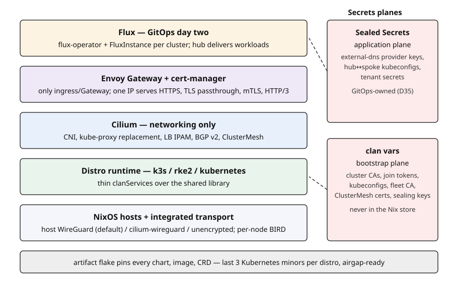

# Architecture overview

The whole design in one paragraph: thin public `rke2` and `k3s` clanServices
(upstream `kubernetes`/kubeadm fully spec'd, implementation reserved — D23)
sit on top of a private shared library (`lib/rancher-cluster/`, target rename
`lib/kube-cluster/`) that owns the shared interfaces, manifest renderers,
vars generators, and assertions. Every cluster gets integrated dual-stack
transport, Cilium as the networking layer, Envoy Gateway as the only
ingress/Gateway implementation, cert-manager always on, and a private
BGP-routed fleet fabric with per-node BIRD. An artifact flake pins every
external dependency. Day two is Flux.

## The layers

**Hosts and transport.** Machines are NixOS clan machines. Each cluster
integrates one transport mode: host WireGuard (default), native Cilium
WireGuard, or an explicit unencrypted underlay. Dual-stack is mandatory
inside every cluster regardless of underlay.

**Distro runtime.** `rke2` and `k3s` are thin services: they own bootstrap,
TLS directory, and join semantics. Everything shared — interfaces,
rendering, secrets, assertions — lives once in the library, so a fix lands
once, not twice.

**Cilium, networking-only (D1).** Cilium is the CNI, kube-proxy replacement,
VXLAN tunnel, pod IPAM, LoadBalancer IPAM, BGP v2 speaker, and ClusterMesh
control plane. Its Gateway and Ingress controllers are permanently disabled
— those features have gaps (no HTTP/3, no mTLS, no DaemonSet mode, no
multi-Gateway IP sharing) that Envoy Gateway fills.

**Envoy Gateway (D2).** The only ingress/Gateway implementation, always
rendered with Gateway API CRDs. Traefik is removed entirely (D3); the
Ingress API is deprecated as a supported surface (D4). See
[Gateways](gateways.md).

**cert-manager.** Always on. It issues the default gateway certificates and
the private fleet-CA trust chain (D18).

**BIRD + BGP fabric.** Per-node BIRD receives VIP routes from Cilium agents
and exports exactly those to your upstream router — ECMP across healthy
nodes. A private fleet fabric is on by default (D10). See
[Networking](networking.md).

**Flux (D28/D36).** Three control-domain modes: standalone clusters run
their own flux-operator and FluxInstance; a hub runs Flux plus the
control-domain plane and pushes to its spokes, which run no Flux at all.
Cilium is adopted by Flux after bootstrap with an eval-time values-parity
guarantee (D29) — locally, or hub-remote on spokes. See [GitOps](gitops.md).

**Artifact flake** (`external-systems/pkgs`). Pins every chart, image, and
CRD; source-builds the last three Kubernetes minors of each distro (D34).
Hermetic and airgap-ready by default.

**Secrets planes (D35).** Clan vars own bootstrap secrets only — CAs, join
tokens, kubeconfigs, sealing keys. In-cluster application credentials are
GitOps-owned via Sealed Secrets. See [Secrets](../guides/secrets.md).

## Where things live

| Component | Owned by |
| --- | --- |
| Bootstrap, TLS dir, join semantics | thin distro service (`rke2` / `k3s`) |
| Interfaces, renderers, vars, assertions | shared library |
| Charts, images, CRDs, distro runtimes | artifact flake (pinned) |
| Gateway controller, pools, classes | clan (L1/L2, zero-churn contract D6) |
| Routes, tenant Gateways, certs, add-ons | GitOps (L3) |

Misconfiguration fails at evaluation wherever possible and is VM-proven
where it cannot be. The full invariant list is SPEC.md §4.
