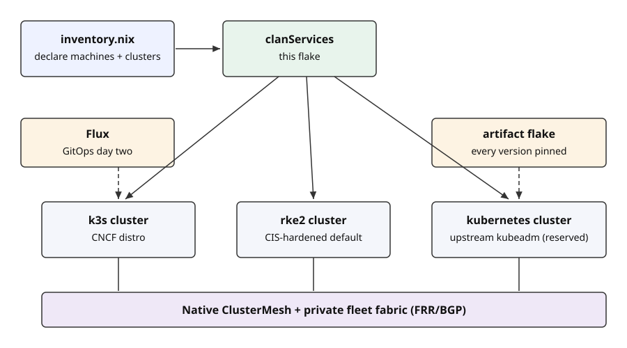

# Kubernetes cluster clanServices

Declare machines in one file. Get secure, interconnected Kubernetes clusters.

External Systems — 2026-10-20

Note: Press `S` for the speaker view, `F` for fullscreen.

---

## The problem, solved

- Declare machines and clusters in `inventory.nix` — get working clusters
- Secure and interconnected by default, no cloud provider needed
- GitOps day two: change applications with git commits, not server rebuilds

---

## What you get

- Any distro: k3s, rke2, or upstream Kubernetes (kubeadm)
- Enterprise networking without a cloud: LoadBalancer IPs, BGP, gateways, multi-cluster mesh
- Airgap-ready: every artifact local at boot
- Every version pinned: last 3 Kubernetes minors per distro

---

Note: One inventory in, three cluster kinds out, meshed by default.

---

Note: Bottom-up: hosts and transport, distro, Cilium, gateways, Flux. Secrets on the side: two planes.

---

- The hub cluster delivers workloads to spokes through Flux
- Spoke API servers are reachable via ClusterMesh mirror Services
- Admin machines reach everything through the BGP fleet fabric

---

## Detail map: every component by layer

- **Hosts**: NixOS; WireGuard transport; per-node BIRD; fleet-routing (client/admin/router) for non-cluster machines
- **Distro**: k3s / rke2 (CIS default) / kubernetes (kubeadm, reserved); thin clanServices over one shared library
- **Networking**: Cilium — CNI, LB IPAM (2 scopes × 4 delivery modes), BGP v2, ClusterMesh; networking only, no Gateway/Ingress
- **Edge**: Envoy Gateway — classes/instances, one IP for HTTPS + TLS passthrough + mTLS + HTTP/3; cert-manager always on
- **Day two**: Flux per control domain — standalone clusters run their own; a hub runs the control plane and pushes to spokes (spokes run no Flux); external-dns optional; Sealed Secrets for app secrets; read-only (no-secrets) kubeconfigs for AI agents
- **Packaging**: artifact flake — pinned charts/images/CRDs, source-built distros, airgap default

---

## Status and roadmap

- **Done**: imported baseline (`692807c`); wireguard-mesh + rke2/k3s single/join/HA VM suites green
- **Next**: artifact flake — last-3-minor packaging, pinned components, update-time Helm inflation committed as source
- **Then**: transport modes, pools + default gateways, BGP fabric, automatic ClusterMesh, PKI ops
- **Reserved**: upstream `kubernetes` distro implementation, MCS-API, clan-operator (spoke credential minting)

Note: Full record: SPEC.md + documentation/ in the repo.
