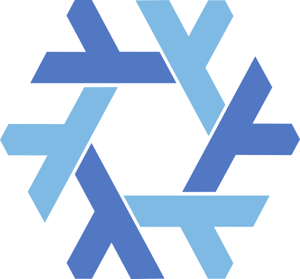

<!-- .slide: data-background-gradient="radial-gradient(circle at 70% 30%, #3a2a22, #141413 70%)" data-transition="zoom" class="title-slide" -->

External Systems

# Kubernetes cluster clanServices

<h2>One inventory. Clusters you can prove.</h2>

→ next topic · ↓ deeper · F full screen · Esc overview · S speaker notes

Note:
Declare machines and clusters in one clan inventory file and get Kubernetes
clusters whose bootstrap and data plane are checked at eval time and proven
in NixOS VM tests. Right arrow for the next topic, down arrow for detail.

---

<!-- .slide: data-background-gradient="radial-gradient(circle at 50% 70%, #3a3226, #1f1e1d 70%)" -->

The idea

## One file in, clusters out

<svg class="sketch" viewBox="0 0 1200 470" style="max-height:440px" xmlns="http://www.w3.org/2000/svg">
<rect x="30" y="120" width="270" height="220" rx="14" stroke="#e3c08d" stroke-width="2" fill="#e3c08d"/>
<image href="icons/lucide-file-text.svg" x="135" y="140" width="60" height="60"/>
<text x="165" y="238" font-size="28" text-anchor="middle" class="mono">inventory.nix</text>
<text x="165" y="272" font-size="19" fill="#b0aea5" text-anchor="middle">machines · tags</text>
<text x="165" y="298" font-size="19" fill="#b0aea5" text-anchor="middle">service instances</text>
<text x="165" y="324" font-size="19" fill="#b0aea5" text-anchor="middle">settings</text>
<line x1="305" y1="230" x2="375" y2="230" stroke="#faf9f5" stroke-width="2" data-arrow/>
<rect x="385" y="40" width="410" height="380" rx="14" stroke="#d97757" stroke-width="3" fill="none"/>
<image href="icons/nixos.svg" x="405" y="58" width="44" height="44"/>
<text x="610" y="90" font-size="27" fill="#d97757" text-anchor="middle" font-weight="700">clan + clanServices</text>
<g class="fragment fade-in" data-fragment-index="1">
<rect x="410" y="125" width="360" height="56" rx="10" stroke="#6a9bcc" stroke-width="2" fill="#6a9bcc"/>
<image href="icons/lucide-network.svg" x="425" y="135" width="36" height="36"/>
<text x="480" y="162" font-size="22" text-anchor="start"><tspan class="mono">netif</tspan> · host links (IfState)</text>
<rect x="410" y="195" width="360" height="56" rx="10" stroke="#6a9bcc" stroke-width="2" fill="#6a9bcc"/>
<image href="icons/wireguard.svg" x="425" y="205" width="36" height="36"/>
<text x="472" y="231" font-size="18" text-anchor="start"><tspan class="mono">routed-fabric</tspan> or <tspan class="mono">wireguard-mesh</tspan></text>
<rect x="410" y="265" width="360" height="56" rx="10" stroke="#6a9bcc" stroke-width="2" fill="#6a9bcc"/>
<image href="icons/cncf-k3s.svg" x="425" y="277" width="36" height="32"/>
<text x="480" y="302" font-size="22" text-anchor="start"><tspan class="mono">k3s</tspan> or <tspan class="mono">rke2</tspan> · distro + PKI</text>
<rect x="410" y="335" width="360" height="56" rx="10" stroke="#6a9bcc" stroke-width="2" fill="#6a9bcc"/>
<image href="icons/cilium.svg" x="425" y="345" width="36" height="36"/>
<text x="480" y="372" font-size="22" text-anchor="start">Cilium bootstrap bundle</text>
</g>
<g class="fragment fade-in" data-fragment-index="2">
<line x1="800" y1="230" x2="870" y2="230" stroke="#faf9f5" stroke-width="2" data-arrow/>
<rect x="880" y="40" width="290" height="110" rx="14" stroke="#8fa876" stroke-width="2" fill="#8fa876"/>
<image href="icons/cncf-k3s.svg" x="898" y="62" width="40" height="34"/>
<text x="1040" y="88" font-size="23" text-anchor="middle">cluster a · k3s</text>
<image href="icons/lucide-server.svg" x="975" y="104" width="30" height="30"/>
<image href="icons/lucide-server.svg" x="1015" y="104" width="30" height="30"/>
<image href="icons/lucide-server.svg" x="1055" y="104" width="30" height="30"/>
<rect x="880" y="175" width="290" height="110" rx="14" stroke="#8fa876" stroke-width="2" fill="#8fa876"/>
<image href="icons/rancher.svg" x="896" y="200" width="46" height="24"/>
<text x="1040" y="223" font-size="23" text-anchor="middle">cluster b · rke2</text>
<image href="icons/lucide-server.svg" x="975" y="239" width="30" height="30"/>
<image href="icons/lucide-server.svg" x="1015" y="239" width="30" height="30"/>
<image href="icons/lucide-server.svg" x="1055" y="239" width="30" height="30"/>
<rect x="880" y="310" width="290" height="110" rx="14" stroke="#8fa876" stroke-width="2" fill="#8fa876"/>
<image href="icons/lucide-router.svg" x="900" y="335" width="36" height="36"/>
<text x="1050" y="360" font-size="23" text-anchor="middle">admins · borders</text>
<text x="1050" y="392" font-size="18" fill="#b0aea5" text-anchor="middle">routes only, no cluster</text>
</g>
<g class="fragment fade-in" data-fragment-index="3">
<image href="icons/flux-cd.svg" x="380" y="430" width="34" height="34"/>
<image href="icons/cncf-argo.svg" x="420" y="430" width="34" height="34"/>
<text x="470" y="456" font-size="22" fill="#e3c08d" text-anchor="start">day two: your GitOps repo adopts the same manifests</text>
</g>
</svg>

Note:
Everything starts from the clan inventory: machines, tags and service
instances. The clanServices in this repo turn it into host links, an
encrypted transport, a Kubernetes distro and a Cilium bundle. Out come
clusters plus machines that only need routes, like admin laptops and border
routers. After day one, a GitOps repo of your choice takes over.

---

Scope

## Two day-one contracts

<b>Bootstrap</b>
the cluster exists and is reachable
<ul>
<li>install and join (k3s, rke2)</li>
<li>cluster PKI and rotation</li>
<li>per-node HAProxy API HA</li>
<li>one bundle, applied once</li>
</ul>

<b>Data plane</b>
packets flow correctly
<ul>
<li>Cilium multi-pool, native or VXLAN</li>
<li>FRR: BGP, BFD, Zebra</li>
<li>WireGuard per adjacency</li>
<li>ClusterMesh with selective peers</li>
</ul>

<b>Everything else</b>
day-two GitOps
<ul>
<li>proxies, cert-manager, DNS</li>
<li>storage, KubeVirt, CCMs</li>
<li>documented recipes</li>
<li>never rendered by clan</li>
</ul>

Clan owns what must exist before GitOps can run. <strong>Nothing more.</strong>

Note:
Two contracts, both verifiable: the cluster exists and you can reach it,
and packets flow where they should and nowhere else. Everything that
lives inside the cluster after that is GitOps: we document it, we never
render it from the host.

---

Architecture

## The stack, layer by layer

<b>Day two</b> · GitOpsoperator-owned, never clan-rendered

<b>Networking</b> · Ciliummulti-pool, native or VXLAN, ClusterMesh

<b>Distro</b> · k3s, rke2thin services over one shared lib

<b>Transport</b> · WireGuard + FRR<code>routed-fabric</code> or <code>wireguard-mesh</code>

<b>Host</b> · NixOS + IfState<code>netif</code>, live reconcile, no reboot

<b>Packaging</b> · <code>pkgs</code> flakepins, overlays, airgap artifacts

Note:
Read it bottom up. The pkgs flake pins nixpkgs and builds every artifact.
NixOS and IfState own the host links. WireGuard and FRR carry traffic
between hosts. k3s or rke2 run on top, Cilium does pod networking, and the
operator's GitOps repo owns everything above that.

---

Host network

## netif renders, IfState reconciles

<svg class="sketch" viewBox="0 0 1200 300" style="max-height:300px" xmlns="http://www.w3.org/2000/svg">
<rect x="20" y="60" width="250" height="150" rx="14" stroke="#e3c08d" stroke-width="2" fill="#e3c08d"/>
<image href="icons/lucide-network.svg" x="120" y="78" width="50" height="50"/>
<text x="145" y="160" font-size="24" text-anchor="middle" class="mono">netif</text>
<text x="145" y="190" font-size="18" fill="#b0aea5" text-anchor="middle">links · VLAN · bond · bridge</text>
<line x1="275" y1="135" x2="320" y2="135" stroke="#faf9f5" stroke-width="2" data-arrow/>
<rect x="325" y="60" width="260" height="150" rx="14" stroke="#6a9bcc" stroke-width="2" fill="#6a9bcc"/>
<image href="icons/lucide-file-cog.svg" x="430" y="78" width="50" height="50"/>
<text x="455" y="160" font-size="20" text-anchor="middle" class="mono">ifstate.settings</text>
<text x="455" y="190" font-size="18" fill="#b0aea5" text-anchor="middle">one YAML per host</text>
<line x1="590" y1="135" x2="635" y2="135" stroke="#faf9f5" stroke-width="2" data-arrow/>
<rect x="640" y="60" width="250" height="150" rx="14" stroke="#d97757" stroke-width="2" fill="#d97757"/>
<image href="icons/lucide-refresh-cw.svg" x="740" y="78" width="50" height="50"/>
<text x="765" y="160" font-size="20" text-anchor="middle" class="mono">ifstatecli apply</text>
<text x="765" y="190" font-size="18" fill="#b0aea5" text-anchor="middle">netlink, in place</text>
<line x1="895" y1="135" x2="940" y2="135" stroke="#faf9f5" stroke-width="2" data-arrow/>
<rect x="945" y="60" width="235" height="150" rx="14" stroke="#8fa876" stroke-width="2" fill="#8fa876"/>
<image href="icons/lucide-cpu.svg" x="1037" y="78" width="50" height="50"/>
<text x="1062" y="160" font-size="22" text-anchor="middle">kernel</text>
<text x="1062" y="190" font-size="18" fill="#b0aea5" text-anchor="middle">links · addrs · routes</text>
<g class="fragment fade-in">
<text x="600" y="260" font-size="22" fill="#e3c08d" text-anchor="middle">FRR owns dynamic routes · Cilium owns its devices and table 200</text>
</g>
</svg>

<ul class="ticks">
<li>Changes apply live; no reboot, no systemd-networkd, no scripted units</li>
<li><code>ifstatecli check</code> is the dry run; multi-instance <code>netif</code> rejects conflicts at eval</li>
</ul>

Note:
netif is multi-instance: one instance per site or segment, each owning
specific links. It renders a single IfState configuration per host, and
IfState reconciles the kernel over netlink without a reboot. FRR and
Cilium own their own objects; IfState is told to leave them alone.

---

<!-- .slide: data-background-gradient="radial-gradient(circle at 50% 30%, #2f2a26, #1f1e1d 70%)" -->

Transport

## routed-fabric: leaves and spines

<svg class="sketch" viewBox="0 0 1200 470" style="max-height:440px" xmlns="http://www.w3.org/2000/svg">
<rect x="330" y="40" width="180" height="100" rx="14" stroke="#d97757" stroke-width="2" fill="#d97757"/>
<image href="icons/lucide-server.svg" x="345" y="62" width="40" height="40"/>
<text x="450" y="85" font-size="24" text-anchor="middle">spine-1</text>
<text x="450" y="115" font-size="17" fill="#b0aea5" text-anchor="middle">FRR · BFD</text>
<rect x="690" y="40" width="180" height="100" rx="14" stroke="#d97757" stroke-width="2" fill="#d97757"/>
<image href="icons/lucide-server.svg" x="705" y="62" width="40" height="40"/>
<text x="810" y="85" font-size="24" text-anchor="middle">spine-2</text>
<text x="810" y="115" font-size="17" fill="#b0aea5" text-anchor="middle">FRR · BFD</text>
<line x1="515" y1="90" x2="685" y2="90" stroke="#e3c08d" stroke-width="2" data-dash/>
<rect x="95" y="320" width="170" height="90" rx="14" stroke="#6a9bcc" stroke-width="2" fill="#6a9bcc"/>
<image href="icons/cncf-k3s.svg" x="110" y="335" width="36" height="30"/>
<text x="200" y="358" font-size="21" text-anchor="middle">k3s node</text>
<text x="180" y="392" font-size="16" fill="#b0aea5" text-anchor="middle">leaf</text>
<rect x="375" y="320" width="170" height="90" rx="14" stroke="#6a9bcc" stroke-width="2" fill="#6a9bcc"/>
<image href="icons/rancher.svg" x="388" y="340" width="40" height="20"/>
<text x="482" y="358" font-size="21" text-anchor="middle">rke2 node</text>
<text x="460" y="392" font-size="16" fill="#b0aea5" text-anchor="middle">leaf</text>
<rect x="655" y="320" width="170" height="90" rx="14" stroke="#6a9bcc" stroke-width="2" fill="#6a9bcc"/>
<image href="icons/lucide-user.svg" x="670" y="333" width="34" height="34"/>
<text x="760" y="358" font-size="21" text-anchor="middle">admin</text>
<text x="740" y="392" font-size="16" fill="#b0aea5" text-anchor="middle">leaf</text>
<rect x="935" y="320" width="170" height="90" rx="14" stroke="#6a9bcc" stroke-width="2" fill="#6a9bcc"/>
<image href="icons/lucide-house.svg" x="950" y="333" width="34" height="34"/>
<text x="1040" y="358" font-size="21" text-anchor="middle">home</text>
<text x="1020" y="392" font-size="16" fill="#b0aea5" text-anchor="middle">leaf behind NAT</text>
<g class="fragment fade-in" data-fragment-index="1">
<line x1="180" y1="315" x2="420" y2="145" stroke="#d97757" stroke-width="2"/>
<line x1="180" y1="315" x2="780" y2="145" stroke="#d97757" stroke-width="2"/>
<line x1="460" y1="315" x2="430" y2="145" stroke="#d97757" stroke-width="2"/>
<line x1="460" y1="315" x2="790" y2="145" stroke="#d97757" stroke-width="2"/>
<line x1="740" y1="315" x2="440" y2="145" stroke="#d97757" stroke-width="2"/>
<line x1="740" y1="315" x2="800" y2="145" stroke="#d97757" stroke-width="2"/>
<line x1="1020" y1="315" x2="460" y2="145" stroke="#d97757" stroke-width="2"/>
<line x1="1020" y1="315" x2="820" y2="145" stroke="#d97757" stroke-width="2"/>
<image href="icons/wireguard.svg" x="40" y="180" width="40" height="40"/>
<text x="90" y="198" font-size="20" text-anchor="start">each line: one WireGuard</text>
<text x="90" y="224" font-size="20" text-anchor="start">interface + eBGP + BFD</text>
</g>
<g class="fragment fade-in" data-fragment-index="2">
<line x1="875" y1="70" x2="985" y2="70" stroke="#8fa876" stroke-width="2" data-arrow/>
<image href="icons/lucide-globe.svg" x="995" y="45" width="48" height="48"/>
<text x="1060" y="66" font-size="20" text-anchor="start">border</text>
<text x="1060" y="92" font-size="17" fill="#b0aea5" text-anchor="start">to upstream</text>
</g>
</svg>

Two spines = <strong>active-active ECMP</strong>. Leaves never carry transit.

↓ why one interface per pair · a packet's path

Note:
Every leaf peers with every spine, and spines peer with each other.
Each pair gets its own WireGuard interface with eBGP and BFD on top.
Spines readvertise with next-hop-self; leaves never carry transit. A spine
can also be a border towards an upstream router.

--

<!-- .slide: data-transition="fade" -->

## Why one interface per pair?

<svg class="sketch" viewBox="0 0 1200 380" style="max-height:380px" xmlns="http://www.w3.org/2000/svg">
<text x="290" y="36" font-size="26" fill="#c9789a" text-anchor="middle">one wg0, two peers</text>
<rect x="190" y="240" width="200" height="80" rx="12" stroke="#6a9bcc" stroke-width="2" fill="#6a9bcc"/>
<text x="290" y="288" font-size="22" text-anchor="middle" class="mono">leaf · wg0</text>
<rect x="60" y="70" width="170" height="70" rx="12" stroke="#d97757" stroke-width="2" fill="#d97757"/>
<text x="145" y="113" font-size="22" text-anchor="middle">spine-1</text>
<rect x="350" y="70" width="170" height="70" rx="12" stroke="#d97757" stroke-width="2" fill="#d97757"/>
<text x="435" y="113" font-size="22" text-anchor="middle">spine-2</text>
<line x1="260" y1="235" x2="160" y2="145" stroke="#faf9f5" stroke-width="2"/>
<line x1="320" y1="235" x2="420" y2="145" stroke="#faf9f5" stroke-width="2"/>
<line x1="265" y1="165" x2="315" y2="215" stroke="#c9789a" stroke-width="4"/>
<line x1="315" y1="165" x2="265" y2="215" stroke="#c9789a" stroke-width="4"/>
<text x="290" y="355" font-size="19" fill="#b0aea5" text-anchor="middle">AllowedIPs cannot overlap: one peer wins</text>
<line x1="600" y1="40" x2="600" y2="340" stroke="#363430" stroke-width="2" data-dash/>
<g class="fragment fade-in">
<text x="910" y="36" font-size="26" fill="#8fa876" text-anchor="middle">wg-s1 + wg-s2</text>
<rect x="810" y="240" width="200" height="80" rx="12" stroke="#6a9bcc" stroke-width="2" fill="#6a9bcc"/>
<text x="910" y="288" font-size="22" text-anchor="middle">leaf</text>
<rect x="680" y="70" width="170" height="70" rx="12" stroke="#d97757" stroke-width="2" fill="#d97757"/>
<text x="765" y="113" font-size="22" text-anchor="middle">spine-1</text>
<rect x="970" y="70" width="170" height="70" rx="12" stroke="#d97757" stroke-width="2" fill="#d97757"/>
<text x="1055" y="113" font-size="22" text-anchor="middle">spine-2</text>
<line x1="860" y1="235" x2="780" y2="145" stroke="#8fa876" stroke-width="2"/>
<line x1="960" y1="235" x2="1040" y2="145" stroke="#8fa876" stroke-width="2"/>
<text x="790" y="200" font-size="18" text-anchor="end" class="mono">wg-s1</text>
<text x="1030" y="200" font-size="18" text-anchor="start" class="mono">wg-s2</text>
<text x="910" y="355" font-size="19" fill="#b0aea5" text-anchor="middle">pods via wg-s1 and wg-s2: kernel ECMP</text>
</g>
</svg>

Note:
WireGuard AllowedIPs is both the routing table and the inbound source
filter. Two peers on one interface cannot both own the same prefixes, so
ECMP is impossible there. One interface per pair gives Linux two routes to
choose from, and BFD pulls a dead one out.

--

<!-- .slide: data-transition="fade" -->

## A packet's path, native routing

<svg class="sketch" viewBox="0 0 1200 300" style="max-height:300px" xmlns="http://www.w3.org/2000/svg">
<rect x="10" y="90" width="170" height="110" rx="12" stroke="#c9789a" stroke-width="2" fill="#c9789a"/>
<image href="icons/cilium.svg" x="72" y="104" width="46" height="46"/>
<text x="95" y="180" font-size="20" text-anchor="middle">pod on leaf A</text>
<line x1="185" y1="145" x2="235" y2="145" stroke="#faf9f5" stroke-width="2" data-arrow/>
<rect x="240" y="90" width="170" height="110" rx="12" stroke="#6a9bcc" stroke-width="2" fill="#6a9bcc"/>
<image href="icons/lucide-route.svg" x="302" y="104" width="46" height="46"/>
<text x="325" y="180" font-size="20" text-anchor="middle">kernel FIB</text>
<line x1="415" y1="145" x2="465" y2="145" stroke="#faf9f5" stroke-width="2" data-arrow/>
<rect x="470" y="90" width="170" height="110" rx="12" stroke="#d97757" stroke-width="2" fill="#d97757"/>
<image href="icons/wireguard.svg" x="532" y="104" width="46" height="46"/>
<text x="555" y="180" font-size="20" text-anchor="middle" class="mono">wg-s1</text>
<line x1="645" y1="145" x2="695" y2="145" stroke="#faf9f5" stroke-width="2" data-arrow/>
<rect x="700" y="90" width="170" height="110" rx="12" stroke="#d97757" stroke-width="2" fill="#d97757"/>
<image href="icons/lucide-server.svg" x="762" y="104" width="46" height="46"/>
<text x="785" y="180" font-size="20" text-anchor="middle">spine-1</text>
<line x1="875" y1="145" x2="925" y2="145" stroke="#faf9f5" stroke-width="2" data-arrow/>
<rect x="930" y="90" width="250" height="110" rx="12" stroke="#c9789a" stroke-width="2" fill="#c9789a"/>
<image href="icons/cilium.svg" x="1032" y="104" width="46" height="46"/>
<text x="1055" y="180" font-size="20" text-anchor="middle">pod on leaf B</text>
<text x="325" y="240" font-size="18" fill="#b0aea5" text-anchor="middle">route learned by FRR</text>
<text x="785" y="240" font-size="18" fill="#b0aea5" text-anchor="middle">next-hop-self</text>
<text x="600" y="50" font-size="22" fill="#e3c08d" text-anchor="middle">no VXLAN: pods are routed like any other prefix</text>
</svg>

Note:
In the native profile Cilium hands non-local pod traffic to the kernel.
FRR has already installed the remote pod pools, so the FIB sends the
packet into a WireGuard interface towards a spine, which forwards it to
the right leaf.

---

Transport profiles

## Two ways to connect nodes

routed-fabric · native

<svg class="sketch" viewBox="0 0 520 240" xmlns="http://www.w3.org/2000/svg">
<circle cx="170" cy="50" r="30" stroke="#d97757" stroke-width="2" fill="#d97757"/>
<circle cx="350" cy="50" r="30" stroke="#d97757" stroke-width="2" fill="#d97757"/>
<circle cx="80" cy="190" r="26" stroke="#6a9bcc" stroke-width="2" fill="#6a9bcc"/>
<circle cx="200" cy="190" r="26" stroke="#6a9bcc" stroke-width="2" fill="#6a9bcc"/>
<circle cx="320" cy="190" r="26" stroke="#6a9bcc" stroke-width="2" fill="#6a9bcc"/>
<circle cx="440" cy="190" r="26" stroke="#6a9bcc" stroke-width="2" fill="#6a9bcc"/>
<line x1="80" y1="164" x2="170" y2="80" stroke="#faf9f5" stroke-width="1.5"/>
<line x1="80" y1="164" x2="350" y2="80" stroke="#faf9f5" stroke-width="1.5"/>
<line x1="200" y1="164" x2="170" y2="80" stroke="#faf9f5" stroke-width="1.5"/>
<line x1="200" y1="164" x2="350" y2="80" stroke="#faf9f5" stroke-width="1.5"/>
<line x1="320" y1="164" x2="170" y2="80" stroke="#faf9f5" stroke-width="1.5"/>
<line x1="320" y1="164" x2="350" y2="80" stroke="#faf9f5" stroke-width="1.5"/>
<line x1="440" y1="164" x2="170" y2="80" stroke="#faf9f5" stroke-width="1.5"/>
<line x1="440" y1="164" x2="350" y2="80" stroke="#faf9f5" stroke-width="1.5"/>
<line x1="200" y1="50" x2="320" y2="50" stroke="#e3c08d" stroke-width="2" data-dash/>
</svg>

<ul class="ticks">
<li>leaf ↔ spine adjacencies, FRR BGP</li>
<li>Cilium native routing, no tunnel</li>
<li>borders, upstream ECMP, many sites</li>
</ul>

wireguard-mesh · tunnel

<svg class="sketch" viewBox="0 0 520 240" xmlns="http://www.w3.org/2000/svg">
<circle cx="260" cy="45" r="28" stroke="#8fa876" stroke-width="2" fill="#8fa876"/>
<circle cx="110" cy="190" r="28" stroke="#8fa876" stroke-width="2" fill="#8fa876"/>
<circle cx="410" cy="190" r="28" stroke="#8fa876" stroke-width="2" fill="#8fa876"/>
<line x1="245" y1="70" x2="125" y2="165" stroke="#faf9f5" stroke-width="2"/>
<line x1="275" y1="70" x2="395" y2="165" stroke="#faf9f5" stroke-width="2"/>
<line x1="140" y1="190" x2="380" y2="190" stroke="#faf9f5" stroke-width="2"/>
<text x="260" y="140" font-size="20" fill="#b0aea5" text-anchor="middle">full mesh</text>
</svg>

<ul class="ticks">
<li>every node peers with every node</li>
<li>Cilium VXLAN over the mesh</li>
<li>small clusters, no BGP needed</li>
</ul>

Note:
Both are supported. routed-fabric is the native, routed design for many
sites and borders. wireguard-mesh is a simple full mesh with Cilium in
VXLAN tunnel mode, good for small clusters. Both export the same generic
node_transport so the distros do not care which one you picked.

---

Load balancers

## Where a Service IP lives

<code>node-fate-bound</code>a provider or static route to one node, no BGPper machine

<code>node-bgp</code>exactly one owner advertises the /32 and /128per machine

<code>shared-bgp</code>every healthy node advertises; upstream ECMPcluster-wide

<code>floating</code>a runtime controller moves one addresscluster-wide

<code>external-class</code>the cloud's controller manager does itcluster-wide

Cilium LB IPAM <strong>allocates</strong>; the pool's delivery mode decides <strong>how traffic arrives</strong>. Node IPAM covers the classless default.

Note:
Allocation and delivery are separate. Each pool has a scope and one of
five delivery modes. Eval rejects combinations that cannot work, such as
node-bgp where there is no BGP or a node-bgp pool with two owners.

---

Many clusters

## ClusterMesh, peered on purpose

<svg class="sketch" viewBox="0 0 1200 380" style="max-height:380px" xmlns="http://www.w3.org/2000/svg">
<rect x="80" y="130" width="250" height="130" rx="16" stroke="#6a9bcc" stroke-width="2" fill="#6a9bcc"/>
<image href="icons/kubernetes.svg" x="100" y="150" width="44" height="44"/>
<text x="230" y="182" font-size="26" text-anchor="middle">cluster A</text>
<text x="205" y="230" font-size="18" fill="#b0aea5" text-anchor="middle">k3s</text>
<rect x="475" y="130" width="250" height="130" rx="16" stroke="#6a9bcc" stroke-width="2" fill="#6a9bcc"/>
<image href="icons/kubernetes.svg" x="495" y="150" width="44" height="44"/>
<text x="625" y="182" font-size="26" text-anchor="middle">cluster B</text>
<text x="600" y="230" font-size="18" fill="#b0aea5" text-anchor="middle">rke2</text>
<rect x="870" y="130" width="250" height="130" rx="16" stroke="#6a9bcc" stroke-width="2" fill="#6a9bcc"/>
<image href="icons/kubernetes.svg" x="890" y="150" width="44" height="44"/>
<text x="1020" y="182" font-size="26" text-anchor="middle">cluster C</text>
<text x="995" y="230" font-size="18" fill="#b0aea5" text-anchor="middle">k3s</text>
<line x1="335" y1="195" x2="470" y2="195" stroke="#8fa876" stroke-width="3"/>
<line x1="730" y1="195" x2="865" y2="195" stroke="#8fa876" stroke-width="3"/>
<text x="402" y="180" font-size="18" fill="#8fa876" text-anchor="middle">peered</text>
<text x="797" y="180" font-size="18" fill="#8fa876" text-anchor="middle">peered</text>
<g class="fragment fade-in">
<polyline points="205,265 205,330 995,330 995,265" stroke="#c9789a" stroke-width="2" fill="none" data-dash/>
<line x1="585" y1="315" x2="615" y2="345" stroke="#c9789a" stroke-width="4"/>
<line x1="615" y1="315" x2="585" y2="345" stroke="#c9789a" stroke-width="4"/>
<text x="600" y="372" font-size="20" fill="#c9789a" text-anchor="middle">not peered: no routes, no global Services</text>
</g>
</svg>

Full peering by default; <strong>selective peers</strong> are symmetric and bound the routes.

↓ hub and spoke

Note:
A mesh group defaults to everything on one fabric instance. You can list
peers explicitly instead. Peering is symmetric and not transitive: A and C
both peer with B but cannot see each other, and VM tests prove that.

--

<!-- .slide: data-transition="fade" -->

## Hub and spoke, without a controller lock-in

<svg class="sketch" viewBox="0 0 1200 400" style="max-height:400px" xmlns="http://www.w3.org/2000/svg">
<rect x="430" y="30" width="340" height="120" rx="16" stroke="#d97757" stroke-width="3" fill="#d97757"/>
<image href="icons/flux-cd.svg" x="455" y="50" width="40" height="40"/>
<image href="icons/cncf-argo.svg" x="455" y="96" width="40" height="40"/>
<text x="625" y="85" font-size="26" text-anchor="middle">hub cluster</text>
<text x="625" y="118" font-size="18" fill="#b0aea5" text-anchor="middle">your GitOps controller</text>
<rect x="80" y="260" width="250" height="100" rx="16" stroke="#6a9bcc" stroke-width="2" fill="#6a9bcc"/>
<text x="205" y="305" font-size="24" text-anchor="middle">spoke</text>
<text x="205" y="335" font-size="17" fill="#b0aea5" text-anchor="middle">no controller</text>
<rect x="475" y="260" width="250" height="100" rx="16" stroke="#6a9bcc" stroke-width="2" fill="#6a9bcc"/>
<text x="600" y="305" font-size="24" text-anchor="middle">spoke</text>
<text x="600" y="335" font-size="17" fill="#b0aea5" text-anchor="middle">no controller</text>
<rect x="870" y="260" width="250" height="100" rx="16" stroke="#6a9bcc" stroke-width="2" fill="#6a9bcc"/>
<text x="995" y="305" font-size="24" text-anchor="middle">spoke</text>
<text x="995" y="335" font-size="17" fill="#b0aea5" text-anchor="middle">no controller</text>
<line x1="520" y1="155" x2="230" y2="255" stroke="#faf9f5" stroke-width="2" data-arrow/>
<line x1="600" y1="155" x2="600" y2="255" stroke="#faf9f5" stroke-width="2" data-arrow/>
<line x1="680" y1="155" x2="970" y2="255" stroke="#faf9f5" stroke-width="2" data-arrow/>
<g class="fragment fade-in">
<image href="icons/lucide-key-round.svg" x="120" y="160" width="30" height="30"/>
<text x="160" y="182" font-size="19" text-anchor="start">kubeconfig Secret per spoke</text>
<image href="icons/lucide-eye.svg" x="880" y="160" width="30" height="30"/>
<text x="920" y="182" font-size="19" text-anchor="start">mirror Services</text>
</g>
</svg>

<code>controlDomain.role</code> = standalone, hub or spoke · any GitOps tool · nothing installed by clan

Note:
Clan renders the substrate: mirror Services, gitops-hub identities and a
kubeconfig Secret per spoke. Flux or Argo on the hub consumes them. The
spokes run no controller at all.

---

Day one to day two

## One bundle, then GitOps

<svg class="sketch" viewBox="0 0 1200 300" style="max-height:300px" xmlns="http://www.w3.org/2000/svg">
<rect x="20" y="70" width="260" height="140" rx="14" stroke="#e3c08d" stroke-width="2" fill="#e3c08d"/>
<image href="icons/lucide-package.svg" x="125" y="86" width="50" height="50"/>
<text x="150" y="168" font-size="22" text-anchor="middle">kubenix renders</text>
<text x="150" y="194" font-size="17" fill="#b0aea5" text-anchor="middle">one manifest set</text>
<line x1="285" y1="140" x2="325" y2="140" stroke="#faf9f5" stroke-width="2" data-arrow/>
<rect x="330" y="70" width="260" height="140" rx="14" stroke="#d97757" stroke-width="2" fill="#d97757"/>
<image href="icons/kubernetes.svg" x="435" y="86" width="50" height="50"/>
<text x="460" y="168" font-size="22" text-anchor="middle">server-side apply</text>
<text x="460" y="194" font-size="17" fill="#b0aea5" text-anchor="middle">once, on clusterInit</text>
<line x1="595" y1="140" x2="635" y2="140" stroke="#faf9f5" stroke-width="2" data-arrow/>
<rect x="640" y="70" width="260" height="140" rx="14" stroke="#6a9bcc" stroke-width="2" fill="#6a9bcc"/>
<image href="icons/github-light.svg" x="720" y="86" width="44" height="44"/>
<image href="icons/flux-cd.svg" x="776" y="86" width="44" height="44"/>
<text x="770" y="168" font-size="22" text-anchor="middle">GitOps repo</text>
<text x="770" y="194" font-size="17" fill="#b0aea5" text-anchor="middle">adopts the same set</text>
<line x1="905" y1="140" x2="945" y2="140" stroke="#faf9f5" stroke-width="2" data-arrow/>
<rect x="950" y="70" width="230" height="140" rx="14" stroke="#8fa876" stroke-width="2" fill="#8fa876"/>
<image href="icons/lucide-refresh-cw.svg" x="1040" y="86" width="50" height="50"/>
<text x="1065" y="168" font-size="22" text-anchor="middle">first reconcile</text>
<text x="1065" y="194" font-size="17" fill="#b0aea5" text-anchor="middle">is a no-op</text>
<text x="600" y="270" font-size="22" fill="#e3c08d" text-anchor="middle">nothing host-resident · no distro manifests dir · clan never installs a GitOps controller</text>
</svg>

Note:
The whole day-one in-cluster surface is one kubenix-rendered manifest set
per cluster, applied once with server-side apply. The GitOps repo then
adopts exactly the same manifests, so its first reconcile changes nothing.

---

Packaging

## pkgs is the artifact authority

<svg class="sketch" viewBox="0 0 1200 360" style="max-height:360px" xmlns="http://www.w3.org/2000/svg">
<rect x="20" y="30" width="400" height="300" rx="16" stroke="#e3c08d" stroke-width="3" fill="#e3c08d"/>
<image href="icons/nixos.svg" x="40" y="48" width="40" height="40"/>
<text x="245" y="78" font-size="24" text-anchor="middle" class="mono">external-systems/pkgs</text>
<text x="50" y="130" font-size="20" text-anchor="start">· nixpkgs and flake-parts pins</text>
<text x="50" y="166" font-size="20" text-anchor="start">· IfState and Kubernetes overlays</text>
<text x="50" y="202" font-size="20" text-anchor="start">· k3s and rke2 runtimes</text>
<text x="50" y="238" font-size="20" text-anchor="start">· committed Cilium manifest</text>
<text x="50" y="274" font-size="20" text-anchor="start">· per-system airgap images</text>
<line x1="425" y1="180" x2="495" y2="180" stroke="#faf9f5" stroke-width="2" data-arrow/>
<rect x="500" y="100" width="300" height="160" rx="16" stroke="#d97757" stroke-width="2" fill="#d97757"/>
<text x="650" y="160" font-size="24" text-anchor="middle" class="mono">clanServices</text>
<text x="650" y="195" font-size="18" fill="#b0aea5" text-anchor="middle">follows pkgs, renders services</text>
<line x1="805" y1="180" x2="875" y2="180" stroke="#faf9f5" stroke-width="2" data-arrow/>
<rect x="880" y="100" width="300" height="160" rx="16" stroke="#8fa876" stroke-width="2" fill="#8fa876"/>
<image href="icons/lucide-house.svg" x="900" y="118" width="36" height="36"/>
<text x="1040" y="160" font-size="24" text-anchor="middle" class="mono">home clan</text>
<text x="1030" y="195" font-size="18" fill="#b0aea5" text-anchor="middle">machines + inventory</text>
<image href="icons/lucide-hard-drive.svg" x="990" y="210" width="36" height="36"/>
</svg>

Airgap-ready: <strong>every artifact is local at boot</strong>, and the last three Kubernetes minors per distro are pinned.

Note:
One flake pins nixpkgs and builds everything that ships: runtimes,
overlays, the Cilium manifest and the airgap image tarballs. clanServices
follows those pins, and the home clan consumes clanServices.

---

Evidence

## How we prove it

<b>Eval tests</b>
in <code>checks</code>
<ul>
<li>nix-unit and assertions</li>
<li>every module covered</li>
<li><code>nix flake check</code> on every change</li>
</ul>

<b>NixOS VM tests</b>
in <code>legacyPackages.vmTests</code>
<ul>
<li>hermetic, sandboxed</li>
<li>each claim prints a <code>*_OK</code> marker</li>
<li>logs in <code>.baton-pass/vm-logs/</code></li>
</ul>

<b>Cloud runs</b>
planned
<ul>
<li>terranix + OpenTofu</li>
<li>Hetzner and GCP first</li>
<li>ephemeral, destroyed after</li>
</ul>

A claim is <strong>VM-proven</strong> only when it names its test file and marker.

Note:
checks stays static, so a full nix flake check is cheap and always run.
VM suites live outside checks and are built one at a time. From now on
SPEC.md only calls something VM-proven when it names the test and the
marker that test prints.

---

Status

## Where we are, honestly

VM-proven

<ul class="ticks">
<li>netif live apply, DHCPv4, SLAAC</li>
<li>WireGuard handshakes</li>
<li>routed-fabric on one flat underlay, spine HA</li>
<li>k3s and rke2: single, join, HA</li>
<li>native data planes</li>
<li>all twelve ClusterMesh variants</li>
</ul>

Planned

<ul class="ticks todo">
<li>NAT sites and external transit</li>
<li>source/return and filter negatives</li>
<li>BGP/BFD only on fabric links</li>
<li>per-path MTU from DHCP links</li>
<li>allocation through clan vars</li>
<li>real clouds and Proxmox</li>
</ul>

Note:
The left column has passing VM suites behind it. The right column is in
the spec as target behavior but not yet proven; the data-plane hardening
plan turns each item into a phase with a ready-to-paste prompt.

---

<!-- .slide: data-background-gradient="radial-gradient(circle at 30% 70%, #3a2a22, #141413 70%)" -->

Next

## Data-plane hardening, in nine phases

<svg class="sketch" viewBox="0 0 1200 330" style="max-height:330px" xmlns="http://www.w3.org/2000/svg">
<line x1="60" y1="165" x2="1140" y2="165" stroke="#363430" stroke-width="4"/>
<circle cx="60" cy="165" r="22" stroke="#8fa876" stroke-width="3" fill="#8fa876" data-fill="solid"/>
<text x="60" y="173" font-size="20" fill="#141413" text-anchor="middle" font-weight="700">0</text>
<text x="60" y="120" font-size="21" text-anchor="middle">docs</text>
<circle cx="180" cy="165" r="22" stroke="#d97757" stroke-width="3" fill="#2b2a27" data-fill="solid"/>
<text x="180" y="173" font-size="20" text-anchor="middle">1</text>
<text x="180" y="225" font-size="21" text-anchor="middle">tooling</text>
<circle cx="300" cy="165" r="22" stroke="#d97757" stroke-width="3" fill="#2b2a27" data-fill="solid"/>
<text x="300" y="173" font-size="20" text-anchor="middle">2</text>
<text x="300" y="120" font-size="21" text-anchor="middle">correctness</text>
<circle cx="420" cy="165" r="22" stroke="#d97757" stroke-width="3" fill="#2b2a27" data-fill="solid"/>
<text x="420" y="173" font-size="20" text-anchor="middle">3</text>
<text x="420" y="225" font-size="21" text-anchor="middle">clan vars</text>
<circle cx="540" cy="165" r="22" stroke="#d97757" stroke-width="3" fill="#2b2a27" data-fill="solid"/>
<text x="540" y="173" font-size="20" text-anchor="middle">4</text>
<text x="540" y="120" font-size="21" text-anchor="middle">netif underlay</text>
<circle cx="660" cy="165" r="22" stroke="#d97757" stroke-width="3" fill="#2b2a27" data-fill="solid"/>
<text x="660" y="173" font-size="20" text-anchor="middle">5</text>
<text x="660" y="225" font-size="21" text-anchor="middle">facts + clans</text>
<circle cx="780" cy="165" r="22" stroke="#d97757" stroke-width="3" fill="#2b2a27" data-fill="solid"/>
<text x="780" y="173" font-size="20" text-anchor="middle">6</text>
<text x="780" y="120" font-size="21" text-anchor="middle">VM harness</text>
<circle cx="900" cy="165" r="22" stroke="#d97757" stroke-width="3" fill="#2b2a27" data-fill="solid"/>
<text x="900" y="173" font-size="20" text-anchor="middle">7</text>
<text x="900" y="225" font-size="21" text-anchor="middle">gateway</text>
<circle cx="1020" cy="165" r="22" stroke="#6a9bcc" stroke-width="3" fill="#2b2a27" data-fill="solid"/>
<text x="1020" y="173" font-size="20" text-anchor="middle">8</text>
<text x="1020" y="120" font-size="21" text-anchor="middle">Hetzner + GCP</text>
<circle cx="1140" cy="165" r="22" stroke="#6a9bcc" stroke-width="3" fill="#2b2a27" data-fill="solid"/>
<text x="1140" y="173" font-size="20" text-anchor="middle">9</text>
<text x="1140" y="225" font-size="21" text-anchor="middle">Proxmox</text>
<text x="480" y="300" font-size="20" fill="#d97757" text-anchor="middle">no cloud account needed</text>
<text x="1080" y="300" font-size="20" fill="#6a9bcc" text-anchor="middle">cloud</text>
</svg>

Each phase has its own <strong>copy-paste prompt</strong> under <code>plans/phase-N-*/</code>.

↓ where it runs · cloud to clan

Note:
Phase zero is this documentation. Phases one to seven run entirely in Nix
and VM tests. Only phases eight and nine need cloud accounts or the
Proxmox host.

--

<!-- .slide: data-transition="fade" -->

## Where it runs: stability first

<svg class="sketch" viewBox="0 0 1200 400" style="max-height:400px" xmlns="http://www.w3.org/2000/svg">
<rect x="40" y="70" width="380" height="270" rx="16" stroke="#e3c08d" stroke-width="2" fill="#e3c08d"/>
<image href="icons/lucide-map-pin.svg" x="60" y="88" width="34" height="34"/>
<text x="250" y="114" font-size="26" text-anchor="middle">Texas · home</text>
<image href="icons/lucide-router.svg" x="70" y="150" width="40" height="40"/>
<text x="125" y="177" font-size="19" text-anchor="start">NixOS router, XGS-PON</text>
<image href="icons/lucide-server.svg" x="70" y="205" width="40" height="40"/>
<text x="125" y="232" font-size="19" text-anchor="start">bare-metal servers</text>
<image href="icons/proxmox.svg" x="70" y="262" width="40" height="40"/>
<text x="125" y="288" font-size="19" text-anchor="start">Proxmox guests</text>
<rect x="780" y="70" width="380" height="270" rx="16" stroke="#6a9bcc" stroke-width="2" fill="#6a9bcc"/>
<image href="icons/lucide-map-pin.svg" x="800" y="88" width="34" height="34"/>
<text x="990" y="114" font-size="26" text-anchor="middle">Europe · cloud</text>
<image href="icons/hetzner.svg" x="810" y="150" width="40" height="40"/>
<text x="865" y="177" font-size="19" text-anchor="start">Hetzner spine, Helsinki</text>
<image href="icons/google-cloud-platform.svg" x="810" y="205" width="40" height="40"/>
<text x="865" y="232" font-size="19" text-anchor="start">GCP spine</text>
<image href="icons/lucide-cloud.svg" x="810" y="262" width="40" height="40"/>
<text x="865" y="288" font-size="19" text-anchor="start">AWS, Azure later</text>
<line x1="425" y1="205" x2="775" y2="205" stroke="#d97757" stroke-width="3" data-dash/>
<text x="600" y="185" font-size="20" fill="#d97757" text-anchor="middle">≈130 ms · ±20 ms · ≤2% loss</text>
<text x="600" y="240" font-size="18" fill="#b0aea5" text-anchor="middle">WireGuard over the Internet</text>
<g class="fragment fade-in">
<text x="600" y="385" font-size="22" fill="#8fa876" text-anchor="middle">zero flaps on the WAN profile · withdraw ≤ 15 s · hold-down before reuse</text>
</g>
</svg>

Note:
Clients are in Texas, the first cloud spines are in Helsinki. Over that
link stability matters more than fast failover: the WAN timer profile
tolerates jitter and loss without flapping, and a recovered path waits out
a hold-down before carrying traffic again.

--

<!-- .slide: data-transition="fade" -->

## Cloud to clan, and back

<svg class="sketch" viewBox="0 0 1200 400" style="max-height:400px" xmlns="http://www.w3.org/2000/svg">
<rect x="20" y="40" width="250" height="120" rx="14" stroke="#e3c08d" stroke-width="2" fill="#e3c08d"/>
<image href="icons/lucide-file-text.svg" x="40" y="58" width="38" height="38"/>
<text x="170" y="86" font-size="20" text-anchor="middle" class="mono">inventory.nix</text>
<text x="145" y="130" font-size="17" fill="#b0aea5" text-anchor="middle">+ allocated vars</text>
<line x1="275" y1="100" x2="325" y2="100" stroke="#faf9f5" stroke-width="2" data-arrow/>
<rect x="330" y="40" width="250" height="120" rx="14" stroke="#6a9bcc" stroke-width="2" fill="#6a9bcc"/>
<image href="icons/nixos.svg" x="350" y="58" width="38" height="38"/>
<text x="470" y="86" font-size="21" text-anchor="middle">terranix</text>
<text x="455" y="130" font-size="17" fill="#b0aea5" text-anchor="middle" class="mono">config.tf.json</text>
<line x1="585" y1="100" x2="635" y2="100" stroke="#faf9f5" stroke-width="2" data-arrow/>
<rect x="640" y="40" width="250" height="120" rx="14" stroke="#d97757" stroke-width="2" fill="#d97757"/>
<image href="icons/opentofu.svg" x="660" y="58" width="38" height="38"/>
<text x="780" y="86" font-size="21" text-anchor="middle">tofu apply</text>
<text x="765" y="130" font-size="17" fill="#b0aea5" text-anchor="middle">state in Hetzner S3</text>
<line x1="895" y1="100" x2="945" y2="100" stroke="#faf9f5" stroke-width="2" data-arrow/>
<rect x="950" y="40" width="230" height="120" rx="14" stroke="#d97757" stroke-width="2" fill="#d97757"/>
<image href="icons/hetzner.svg" x="970" y="58" width="34" height="34"/>
<image href="icons/google-cloud-platform.svg" x="1012" y="58" width="34" height="34"/>
<text x="1065" y="130" font-size="19" text-anchor="middle">machines</text>
<polyline points="1065,165 1065,240 1030,240" stroke="#faf9f5" stroke-width="2" fill="none" data-arrow/>
<rect x="800" y="200" width="225" height="120" rx="14" stroke="#8fa876" stroke-width="2" fill="#8fa876"/>
<text x="912" y="248" font-size="21" text-anchor="middle" class="mono">facts.json</text>
<text x="912" y="285" font-size="17" fill="#b0aea5" text-anchor="middle">IPs · MTU · MACs</text>
<line x1="795" y1="260" x2="745" y2="260" stroke="#faf9f5" stroke-width="2" data-arrow/>
<rect x="490" y="200" width="250" height="120" rx="14" stroke="#8fa876" stroke-width="2" fill="#8fa876"/>
<text x="615" y="248" font-size="21" text-anchor="middle">Nix materializer</text>
<text x="615" y="285" font-size="17" fill="#b0aea5" text-anchor="middle">full literal inventory</text>
<line x1="485" y1="260" x2="435" y2="260" stroke="#faf9f5" stroke-width="2" data-arrow/>
<rect x="180" y="200" width="250" height="120" rx="14" stroke="#8fa876" stroke-width="2" fill="#8fa876"/>
<image href="icons/lucide-terminal.svg" x="200" y="218" width="34" height="34"/>
<text x="320" y="245" font-size="20" text-anchor="middle">install + probe</text>
<text x="305" y="285" font-size="17" fill="#b0aea5" text-anchor="middle">then tofu destroy</text>
<text x="600" y="375" font-size="21" fill="#e3c08d" text-anchor="middle">ephemeral: nothing committed back · 4 h default, 24 h max · $100 a month</text>
</svg>

Note:
terranix turns the inventory and its allocated vars into OpenTofu JSON, so
there is no hand-written HCL. OpenTofu creates the machines and reports
what only the provider knows in facts.json. A pure Nix materializer turns
that into a full inventory, clan installs it, probes check it, and
everything is destroyed. Nothing is committed back.

---

<!-- .slide: data-background-gradient="radial-gradient(circle at 70% 30%, #3a2a22, #141413 70%)" class="title-slide" -->

Read more

## The spec is the source of truth

<b>SPEC.md</b>contract and status

<b>Docs site</b>architecture and services

<b>Hardening plan</b>phases and prompts

<b>clanServices</b>external-systems on GitHub

Esc for an overview of every slide

Note:
SPEC.md in the repository root is both the target contract and the status
authority. The documentation site renders the same content for people,
and the hardening plan lists what comes next.
